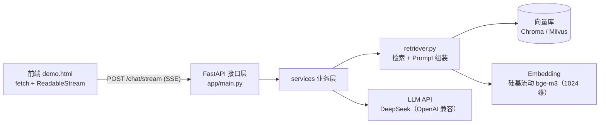

# kb-agent · 企业知识库问答 Agent

> 基于 **RAG（检索增强生成）** 的企业知识库问答服务：把公司文档分块向量化入库，用户提问时先检索最相关的段落，再让大模型**只依据这些段落**流式生成回答并附带引用来源。
> 额外提供 **Agent 工具调用**（RAG 即工具 + 私有数据查询）、**评估集量化指标**与**单元测试**，可 Docker 一键部署。

---

## ✨ 功能特性

| 能力 | 说明 |
|------|------|
| 🔍 **RAG 问答** | 文档分块 → 向量化 → 相似度检索 → 阈值过滤 → 大模型生成 |
| ⚡ **SSE 流式输出** | 打字机效果；前端用 `fetch` + `ReadableStream` 逐块解析渲染 |
| 📎 **引用来源** | 回答附带命中的原文片段与相关度分数，可核对、可追溯 |
| 🛡️ **防幻觉** | Prompt 强约束"只依据参考资料回答，没有就明说"；评估集含**刁难题**专项验证 |
| 🤖 **Agent 工具调用** | Function Calling 工具集 + 循环上限 + 连续失败熔断（防死循环） |
| 🧠 **多轮记忆** | 会话级上下文累积，支持"那他的年假呢"这类指代 |
| 🔌 **双向量库后端** | **Chroma**（本地零部署）/ **Milvus**（生产级，Docker 三件套），改 `.env` 一行切换 |
| 📊 **评估驱动** | 10 条评估集（9 条知识问答 + 1 条防幻觉刁难题），量化检索命中率与端到端准确率 |
| ✅ **单元测试** | pytest 覆盖判卷等核心纯逻辑，秒级反馈 |
| 🐳 **容器化部署** | 应用镜像 + Milvus 编排（etcd + MinIO + Milvus） |

---

## 🏗 系统架构



**两条数据流**：

```
【入库阶段 · 离线，一次做好】
data/sample 文档 → 加载 → 分块(chunk_size=500, overlap=50) → Embedding → 写入向量库

【问答阶段 · 在线，每次提问】
用户问题 → 向量检索 top_k(=4) → 相关度阈值过滤(0.2) → 拼 Prompt →
LLM 流式生成（逐 token 推送）→ 最后推送引用来源
```

---

## 📁 目录结构

```
kb-agent/
├── app/
│   ├── main.py              # FastAPI 入口：/chat/stream（SSE）、/health、静态挂载
│   └── static/demo.html     # 前端演示页：打字机效果 + 引用来源
├── services/                # 业务层（换向量库/换模型都只改这里）
│   ├── llm.py               # LLM 工厂（全项目唯一创建模型的地方）
│   ├── vector_store.py      # 向量库工厂（chroma | milvus 配置切换）
│   ├── ingest.py            # 文档入库：加载 → 分块 → 向量化 → 写库
│   └── retriever.py         # 检索 + Prompt 链 + 流式问答
├── eval/
│   ├── eval_set.json        # 评估集（含防幻觉刁难题）
│   ├── judge.py             # 判卷纯函数（空格归一化，可单测）
│   └── run_eval.py          # 评估脚本：检索命中率 + 端到端准确率
├── tests/
│   └── test_judge.py        # pytest 单元测试
├── scripts/
│   ├── seed.py              # 批量入库脚本
│   └── compat_check.py      # 环境自检（依赖/API 兼容性）
├── data/sample/             # 演示语料（员工手册 + 客服知识库）
├── docs/                    # 架构、面试讲稿、排错手册
├── config.py                # 配置层（pydantic-settings，路径全部绝对化）
├── docker-compose.yml       # 应用服务
├── docker-compose.milvus.yml# Milvus 三件套（etcd + MinIO + Milvus）
├── requirements.txt         # 依赖声明（版本区间）
└── requirements.lock.txt    # 依赖锁定（本机完整快照）
```

---

## 🚀 快速开始

### 0. 环境要求

- Python 3.12+（开发环境：3.13）
- Docker Desktop（用于启动 Milvus；仅用 Chroma 可跳过）
- API Key：**DeepSeek**（对话）+ **硅基流动**（Embedding，提供 OpenAI 兼容的 `Pro/BAAI/bge-m3`）

> 💡 为什么 Embedding 和对话用不同厂商？**DeepSeek 官方不提供 embeddings 接口**——chat 与 embedding 分开选型是行业常规做法。

### 1. 安装依赖

```bash
pip install -r requirements.txt      # 开发
# 或复现完全一致的环境：
pip install -r requirements.lock.txt
```

### 2. 配置 `.env`

```bash
cp .env.example .env
```

填入你的 Key（见下方"配置项说明"）。

### 3. 启动 Milvus（生产级向量库）

```bash
docker compose -f docker-compose.milvus.yml up -d
docker compose -f docker-compose.milvus.yml ps      # 三个容器应为 Up
curl http://127.0.0.1:9091/healthz                  # 期望输出 OK
```

> 国内网络拉镜像失败时，给镜像加 `quay.m.daocloud.io/`（quay 源）或 `docker.m.daocloud.io/`（Docker Hub 源）前缀。

### 4. 文档入库

```bash
python scripts/seed.py               # 入库 data/sample 下的文档
```

预期输出：`星辰科技员工手册.md: 3 块` 等。

### 5. 启动服务

```bash
uvicorn app.main:app --reload        # 打开 http://127.0.0.1:8000/docs
```

### 6. 验证

- 接口文档：`http://127.0.0.1:8000/docs`
- 前端演示：`http://127.0.0.1:8000/static/demo.html` → 输入"年假满一年可以休几天？"→ 看**打字机效果 + 底部引用来源**
- 健康检查：`http://127.0.0.1:8000/health`

---

## ⚙️ 配置项说明（`.env`）

| 配置项 | 说明 | 示例 |
|--------|------|------|
| `LLM_API_KEY` / `LLM_MODEL` / `LLM_BASE_URL` | 对话模型（OpenAI 兼容协议） | `sk-xxx` / `deepseek-chat` / `https://api.deepseek.com/v1` |
| `EMBEDDING_PROVIDER` | embeddings 提供方 | `siliconflow` |
| `EMBEDDING_MODEL` | 向量模型（1024 维） | `Pro/BAAI/bge-m3` |
| `EMBEDDING_API_KEY` / `EMBEDDING_BASE_URL` | embeddings 凭证与地址 | `sk-xxx` / `https://api.siliconflow.cn/v1` |
| `VECTOR_BACKEND` | **向量库后端切换** | `milvus` 或 `chroma` |
| `MILVUS_URI` | Milvus 服务地址 | `http://127.0.0.1:19530` |
| `RETRIEVER_TOP_K` | 检索返回块数 | `4` |
| `RETRIEVER_SCORE_THRESHOLD` | 相关度阈值（过滤无关块） | `0.2` |

> ⚠️ **配置优先级**：环境变量 / `.env` > 代码默认值。改参数请改 `.env`（改 `config.py` 的默认值不生效）。

---

## 📊 评估结果

同一份评估集（10 条：9 条知识问答 + 1 条防幻觉刁难题），在两种向量库后端上的表现：

| 向量库后端 | 检索命中率 Recall@4 | 端到端准确率 |
|-----------|-------------------|-------------|
| Chroma（本地） | 90% | **100%** |
| **Milvus**（生产级） | 90% | **100%** |

**调参记录（评估驱动开发）**：

| 阶段 | 指标 | 动作 |
|------|------|------|
| 初版 | 20% | 建评估集跑基线 |
| 修正判卷 | 40% | 判卷加**空格归一化**（`'5 天'` vs `'5天'` 误判） |
| 调阈值 | **100%** | `RETRIEVER_SCORE_THRESHOLD` 0.3 → 0.2（改在 `.env`） |

**结论**：换向量库（Chroma → Milvus）上层代码零改动、指标零变化——**分层设计 + 配置驱动的价值兑现**。

运行评估：

```bash
python eval/run_eval.py --basic     # 指标统计
python eval/run_eval.py --show      # 打印检索命中内容，人工检查
```

---

## 🧪 测试

```bash
python -m pytest -v
```

覆盖内容：判卷逻辑（空格归一化、刁难题判定）。

> 理念：**每修完一个 bug，就补一条测试**——踩过的坑不踩第二次。

---

## 🐳 Docker 部署

```bash
# 1) 启动依赖（Milvus 三件套）
docker compose -f docker-compose.milvus.yml up -d

# 2) 构建并启动应用
docker compose up --build -d
```

设计要点：**密钥通过 `env_file` 注入（不进镜像）**；向量库数据用 **volume 持久化**（容器重建不丢）。

---

## 🧭 技术选型

| 组件 | 选型 | 理由 |
|------|------|------|
| Web 框架 | **FastAPI** | 原生异步 + Pydantic 校验 + 自动文档，适配流式场景 |
| 流式协议 | **SSE** | LLM 输出是服务器单向推送，SSE 基于 HTTP、简单、可自动重连 |
| 向量库 | **Chroma / Milvus** | 本地开发用 Chroma；生产用 Milvus（分布式、高并发），配置一键切换 |
| 对话模型 | **DeepSeek**（OpenAI 兼容） | 国内直连、成本低、支持 Function Calling |
| 向量模型 | **bge-m3（硅基流动）** | 中文效果好、1024 维、OpenAI 兼容协议 |
| 编排 | **LangChain 1.x** | 组件化（Prompt / Model / VectorStore）+ LCEL 链式组合 |
| 测试 | **pytest** | 纯逻辑单测，秒级反馈 |

---

## ⚠️ 已知问题 & Roadmap

- [ ] **Milvus 连接未复用**：每次 `get_vector_store()` 会新建连接（日志可见），计划给工厂加实例缓存
- [ ] `requirements.lock.txt` 为本机完整环境快照（含开发期实验依赖），可在干净环境重新生成纯净锁文件
- [ ] **服务无鉴权**：生产部署需补 API Key / 登录鉴权
- [ ] LLM 精排（rerank）尚未服务化（当前为检索直出 top_k）
- [ ] 评估集 10 条 → 扩充到 50+ 条，覆盖更多文档类型
- [ ] 补充集成测试（检索、入库链路）

---

## 📄 License

MIT
