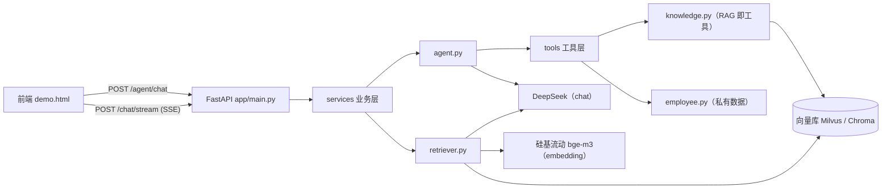

# 系统架构（kb-agent）

> 本文件按**项目实际代码**维护：分层结构 → 三条数据流 → 技术选型 → 设计决策。
> 说明：涉及文件名/接口名的地方均已与实际代码核对。

---

## 1. 总体架构

### ASCII 版（任何环境都能看）

```
                    ┌──────────────────────────────────────────┐
                    │            前端 demo.html                │
                    │      fetch + ReadableStream 流式渲染      │
                    └─────────────────────┬────────────────────┘
                                          │ POST /chat/stream（SSE）
                                          │ POST /agent/chat（工具调用）
                    ┌─────────────────────▼────────────────────┐
                    │      FastAPI 接口层  app/main.py          │
                    │  /chat/stream   /agent/chat   /health    │
                    │  /static（前端静态资源挂载）               │
                    └─────────────────────┬────────────────────┘
                                          │
                    ┌─────────────────────▼────────────────────┐
                    │            services 业务层                │
                    │  retriever.py  检索 + Prompt 组装 + 流式   │
                    │  agent.py      规划-执行-反思（双锁+记忆）  │
                    │  ingest.py     文档入库                   │
                    │  llm.py        LLM 工厂（唯一创建点）      │
                    │  vector_store.py 向量库工厂（双后端）      │
                    └───┬──────────────┬──────────────┬─────────┘
                        │              │              │
          ┌─────────────▼──────┐ ┌─────▼──────┐ ┌─────▼──────────────┐
          │ 向量库（可切换）    │ │ tools 工具层│ │ 外部模型 API        │
          │ · Milvus 2.5.4     │ │ · employee  │ │ · DeepSeek（chat）  │
          │   （etcd + MinIO   │ │   年假查询  │ │ · 硅基流动          │
          │    + Milvus 三容器）│ │ · knowledge │ │   bge-m3（embedding）│
          │ · Chroma（本地备选）│ │   RAG 即工具│ │                    │
          └────────────────────┘ └────────────┘ └────────────────────┘
```

### Mermaid 版（GitHub 自动渲染）



---

## 2. 三条数据流

### ① 入库阶段（离线，一次做好）

```
data/sample 文档（员工手册 / 客服知识库）
  → TextLoader 加载
  → RecursiveCharacterTextSplitter 分块（chunk_size=500, chunk_overlap=50）
  → Embedding 向量化（bge-m3，1024 维）
  → 写入向量库（Milvus / Chroma，随 VECTOR_BACKEND 切换）
```

### ② 问答阶段（在线，每次提问）

```
用户问题
  → 向量检索 top_k(=4)
  → 相关度阈值过滤（score >= 0.2，滤掉无关块）
  → 拼 Prompt（含"只依据参考资料，没有就明说"的防幻觉约束）
  → LLM 流式生成（逐 token 推送 SSE）
  → 最后推送 sources 事件（引用来源：文件、片段、分数）
```

### ③ Agent 阶段（Function Calling，需要"动手查"时）

```
用户问题
  → 模型决策：是否需要调用工具？（输出 tool_calls）
  → 代码执行工具（模型不执行代码！）
      · query_leave_balance   查员工私有数据
      · search_knowledge_base 查公司制度（RAG 即工具）
  → ToolMessage 回填（带 tool_call_id，模型才知道结果属于哪次调用）
  → 模型再决策……循环直到给出最终回答
  安全锁：最大循环 4 轮｜工具连续失败 2 次熔断
  记忆：messages 跨轮累积（短时记忆），支持指代式追问
```

---

## 3. 技术选型与理由

| 组件 | 选型 | 为什么 |
|------|------|--------|
| Web 框架 | **FastAPI** | 原生异步 + Pydantic 校验 + 自动接口文档，适配流式场景 |
| 流式协议 | **SSE** | LLM 输出是服务器单向推送；SSE 基于 HTTP、简单、可自动重连，比 WebSocket 轻 |
| 向量库 | **Milvus 2.5.4**（生产）/ **Chroma**（本地） | Milvus 支持高并发与分布式扩展，是生产首选；Chroma 零部署适合开发。**两者通过 `VECTOR_BACKEND` 一行配置切换** |
| 向量库 SDK | langchain-milvus 0.2.x + pymilvus 2.5.7 | 与 Milvus 2.5.x 服务端匹配的稳定组合（0.3.x 存在连接注册问题） |
| 对话模型 | **DeepSeek**（OpenAI 兼容协议） | 国内直连、成本低、支持 Function Calling |
| 向量模型 | **硅基流动 Pro/BAAI/bge-m3** | 中文效果好、1024 维；**DeepSeek 官方不提供 embeddings 接口**，故 chat 与 embedding 分开选型（行业常规做法） |
| 应用框架 | **LangChain 1.x** | 组件化（Prompt / Model / VectorStore）+ LCEL 链式组合，便于替换与测试 |
| 分块 | RecursiveCharacterTextSplitter（500/50） | 按段落/句子层级切分，中文场景性价比高；overlap 防止语义被切断 |
| 测试 | **pytest** | 纯逻辑单测，秒级反馈 |
| 部署 | **Docker + Compose** | 应用镜像 + Milvus 三件套编排；密钥走 env_file 注入，数据走 volume 持久化 |

---

## 4. 设计决策记录（ADR 精简版）

1. **为什么分层**：让每一层的替换成本最低——换向量库只改 `services/vector_store.py`，换模型只改 `services/llm.py` + `.env`，上层业务零改动（本项目已实测：Chroma → Milvus 上层代码一行未改）。
2. **为什么双向量库后端**：开发期用 Chroma 零部署快速迭代，生产用 Milvus 抗并发；**配置驱动**（`VECTOR_BACKEND`）让两种场景共用同一套代码。
3. **为什么 RAG 管静态知识、Function Calling 管动态数据**：制度手册是静态知识，适合向量检索；员工年假余额等是私有动态数据，**必须查库、模型不能猜**。二者结合即"企业助理"的完整形态。
4. **为什么流式最后才推引用来源**：正文先流完保证体验（首 token 时间），来源一次性推送便于前端渲染；事件用 JSON 结构化（`type` 字段区分 token / sources）便于扩展。
5. **为什么 Agent 需要两道安全锁**：模型可能反复调用同一个失败工具（死循环、白烧 token）——**循环上限**兜住无限循环，**连续失败熔断**给模型一次反思机会后强制终止。
6. **为什么所有路径都用 `BASE_DIR` 锚定**：避免"相对路径跟着当前工作目录跑"（曾导致向量库写错位置、`.env` 读不到）。
7. **为什么配置项在 `.env` 而不在代码**：环境变量 / `.env` 优先级高于代码默认值，改配置无需改代码；密钥也只存 `.env`（`.gitignore` 已屏蔽）。

---

## 5. 模块职责速查

| 模块 | 职责 | 关键接口 |
|------|------|---------|
| `app/main.py` | HTTP 接口层：收发包、静态挂载 | `POST /chat/stream`、`POST /agent/chat`、`GET /health` |
| `services/retriever.py` | 检索 + Prompt 组装 + 流式问答 | `retrieve()`、`ask()`、`ask_stream()`、`_build_chain()` |
| `services/agent.py` | Agent 循环（双锁 + 记忆） | `AgentSession.chat()` |
| `services/ingest.py` | 文档加载 → 分块 → 入库 | `ingest(doc_path)` |
| `services/vector_store.py` | 向量库与 embedding 工厂（双后端） | `get_embeddings()`、`get_vector_store()` |
| `services/llm.py` | LLM 工厂（全项目唯一创建点） | `get_llm()` |
| `tools/employee.py` | 员工年假查询工具 | `query_leave_balance` |
| `tools/knowledge.py` | 知识库检索工具（RAG 即工具） | `search_knowledge_base` |
| `eval/` | 评估集 + 判卷 + 指标统计 | `run_eval.py --basic / --show` |
| `config.py` | 配置层（环境变量 + 绝对路径解析） | `settings`、`BASE_DIR` |
